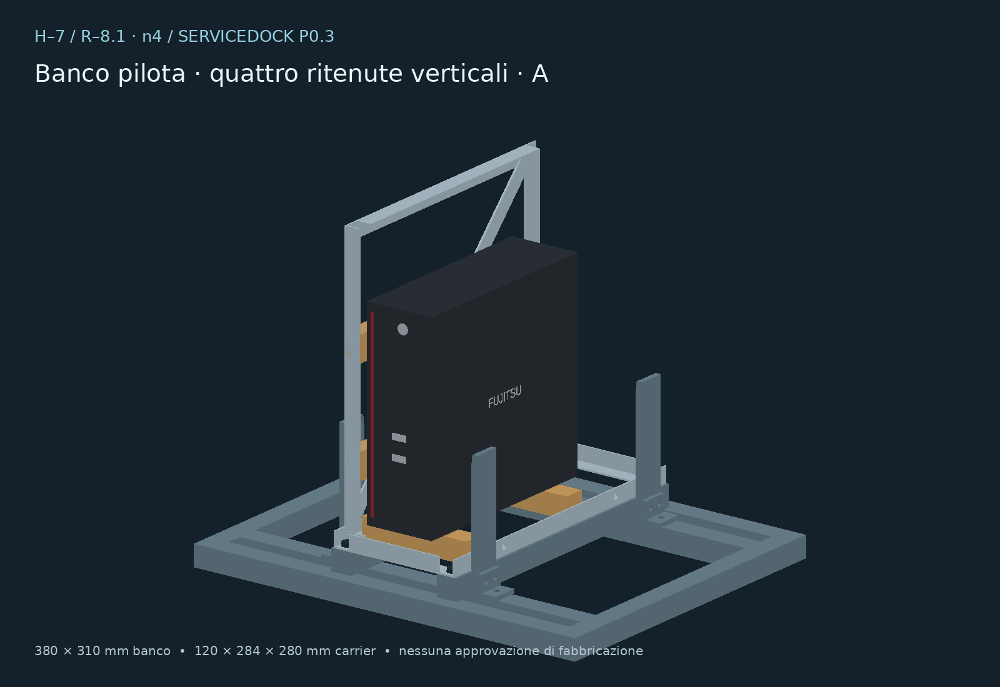
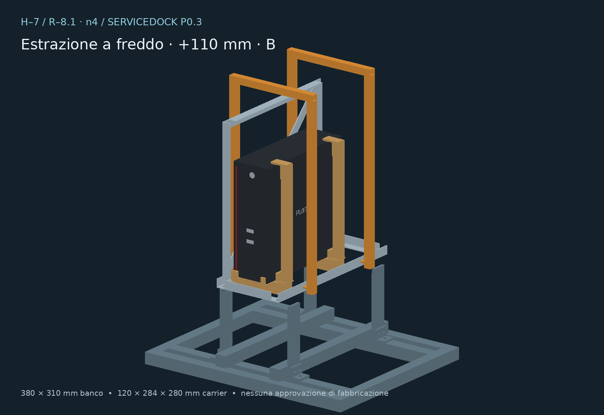

# n4 · P0.3 — Service Dock e giunti del carrier C120
26 novembre 2026 · H-7 R-8.1 · **Revisione virtuale: NO-GO fabbricazione, sollevamento reale e accensione in Torre**.

[Anteprima e tolleranze](index.html) · [CAD](service-dock.scad) · [Distinta incrementale](bom-delta.csv) · [P0.2 adattatori](../p02/) · [P0.1](../)

## Interfaccia invariata
X = trasversale (centro 0); Y = profondità (fronte negativo); Z = verticale, piano appoggio C120 = 0. Ingombro C120 120×284×280; passo 190; guide esterne 138; base Torre 1325×310. Dima 65×195×190; budget nodo 2 kg, insieme mobile 3 kg (da pesare). La variante A usa la cover OEM VESA dopo rilievo; B usa fermi metallici positivi e superfici di contatto solo dove consentito dalle griglie. Non toccare n1.

## Specifica geometrica P0.3
| Elemento | Geometria (mm) | Stato |
|---|---|---|
| 4 ritenute removibili | M5 candidato, X ±52,5, Y ±134, Z0; foro Ø5,5, rondella OD10; testa Ø9,5 | lunghezza/lega/serraggio/antiallontanamento da validare |
| Accesso cacciavite | cilindro Ø10, Z2,5..280,5; luce nominale rispetto a montante A1 1,5 | attrezzo reale e impugnatura da verificare |
| Banco isolato | base 380×310; profili 20×20, due strati; traversi inferiori Z−40..−20 e appoggi Z−20..0 | fissare su supporto stabile; una sede centrale, non la base Torre definitiva |
| 4 guide | X±66, Y±110; 6×25×120, Z−20..100; ingresso smussato 1 su 3; luce 126 senza pattini, 125 con 0,5 per lato | pattini non portanti; sezione/lega/staffa da validare |
| 4 staffe guida | lato esterno sotto Z0, piede 18×25×4, ala 16 alta; M5 su cava e 2 assi M4 per guida | geometria concettuale, giunto e filetti da verificare |
| Riscontri B | 4 piccoli bracci 8×10×1,5 e linguette 8 mm, zona inferiore | sostituiscono barre P0.2; fissaggi e contatti da verificare |
| 4 prese di sollevamento | fori trasversali Ø5,5 in flange verticali, X±60 Y±75 Z7,5 | perni Ø5 solo candidati; blocco positivo e verifica strappo obbligatori |
| 2 portali rimovibili | tubo 12×12×1,5; X ±75 centri gambe, Y±75; estremità rinforzate 20; traversa superiore Z318..330; larghezza 162 | non costituiscono attrezzatura di sollevamento approvata |

Le quattro viti scaricano le forze nella coppia di appoggi longitudinali con dadi a T; nessun perno fisso nel passo fra guide. Il benchmark commerciale è item Profile 5 20×20 (0.0.370.03, 0,48 kg/m) con T-Slot Nut 5 St M5 (0.0.370.01). Profilo rappresentato a sezione piena nell'anteprima, non modello della cava. Verificare compatibilità, profondità, testa, rondelle e coppia stabilita per i pezzi scelti. Le due travi di appoggio ora sono lunghe 284 ciascuna. Ritaglio totale 2,548 m, massa teorica 1,223 kg senza giunti, guide o bulloni. Nessun ordine effettuato.
- [Scheda item 0.0.370.03](https://cdn.item24.com/product-assets/DOK_PROD_37003_%23SEN_%23AIN_%23V1.pdf)
- [Dado a T item 0.0.370.01](https://www.item24.com/en-us/t-slot-nut-5-st-m5-bright-zinc-plated-37001)

## Cinematica ed accessibilità
Guide alte 100 sopra il piano del carrier; corsa nominale 110, quindi luce finale 10. Portali montati esclusivamente a freddo, con riserva mani fino a Z350; servono **460 mm liberi sopra Z0**, più eventuale quota del banco dal pavimento. Prima di installare i portali occorre confermare il corridoio reale per le mani, la presa e i perni. 162 mm corpo temporaneo: distanza nominale da carrier vicino 49 mm e da guida vicina 40 mm. Non includono mani/sporgenze dei fermi. Non usare una presa asimmetrica sul telaio, l'adattatore o la macchina.

Proiezione trasversale prudenziale: W cos(ψ) cos(θ) + D |sin(ψ) cos(θ)| + H |sin(θ)| + 2|offset X|, con angoli piccoli e W misurata; apertura utile effettivamente misurata. Esempio: 120,5 / 124 mm, imbardata 0,2°, inclinazione 0,2°, offset 0,5 mm → circa 0,53 mm residui totali. È uno screening geometrico, non un limite operativo garantito; allineamento verticale, guide parallele, assenza di forzature. Viti completamente rimosse; nessun cavo collegato. Verificare anche la luce di ogni singola guida con dima e spessori.

## Screening strutturale (non certificazione)
Ipotesi 3 kg × 3g = 88,3 N. Caso concentrato su una vite candidata: pressione di contatto nominale F/(1,5×5) ≈ 11,8 MPa; sezione netta della flangia (15−5,5)×1,5 = 14,25 mm² → 6,2 MPa. Non verifica estrazione nello spessore, flessione, fessurazioni, filetto, precarico, fatica. Il produttore del profilo dichiara 500 N di estrazione ammissibile dalla cava nelle proprie condizioni; non è la capacità del sistema assemblato.
Per guida rettangolare ideale 6×25, I=450 mm⁴, carico laterale 44,1 N, L=108, E=69 GPa: σ≈31,8 MPa, freccia≈0,60 mm. Esclusi giunto/staffa, fori e concentrazioni. Foro laterale di presa a Z7,5 lascia 4,75 mm di legamento per lato. Prima di realizzare o usare i portali servono verifica dei quattro punti, perno a ritegno positivo di portata nota, tenuta all'estrazione, carico non uniforme, giunzioni e materiale. Nessun sollevamento sopra persone o apparecchi. Collaudo iniziale con dima inerte supportata dal basso e vincolo stabile, senza carichi sospesi.

## Sequenza (solo dopo approvazione meccanica)
1. Rilievo geometrico e griglie, scelta A o B; pesatura; verificare guide, fissaggi e banco ancorato, senza intervenire su n1.
2. A freddo inserire la dima con movimentazione controllata, verificare gioco, appoggio e parallelismo.
3. Rimuovere i portali, installare le quattro viti con hardware/serraggio convalidati; controllare anti-scorrimento e anti-sollevamento. Applicare marcatura di posizione e registro viti.
4. Per estrarre: arresto, scollegamento AC alla sorgente e macchina, scollegamento dati/accessori, rimozione cavi dal corridoio; controllare assenza di energia e stabilità. Rimuovere tutte e quattro le viti, verificare conteggio. Montare attrezzatura approvata su quattro punti; estrarre verticalmente, senza ruotare/forzare, con appoggio controllato. Abbassare su piano stabile prima di manutenzione. Reinserire invertendo la sequenza.
5. Solo dopo superamento dei gate meccanici, elettrici e termici P0.2: test OEM isolato e poi confronto termico a pari carico, senza n1 in prova. La clearance 200 mm sulle griglie rimane requisito del manuale; nessuna approvazione termica è implicita.

## Risultati virtuali e riproduzione
- `collision.txt`: 20 intersezioni vuote fra carrier/adattatori e tutti i cinque modelli (A/B), incluse le quattro zone utensile. Primo controllo prima della correzione delle prese laterali e staffe sotto Z0; tali elementi non aggiungono volume nel vano PC.
- `sweep.txt`: 6 corse nominali conservative (hull 110 mm, +0,05 per escludere contatto iniziale), dima/Q510/Q520 × A/B: vuote.
- `yoke-final.txt`: 6 verifiche geometriche di portali montati; `yoke-sweep.txt`: 1 sweep dei portali contro banco, vuote. Non contano contatti intenzionali con perni, agganci reali, deformazioni o errori d'assetto.
- Q910 e Q920 condividono le quote rispettivamente di Q510 e Q520; le differenze di griglie e connettori restano fuori da questi test.
- Generare STL ausiliari (non per fabbricazione): `for m in A B carrier bench screws tools yoke; do openscad -o "$m.stl" -D "mode=\"$m\"" service-dock.scad; done`. I render derivano da queste geometrie e dalla dima; `python make_render.py` (numpy, Pillow; font DejaVu Sans; generare anche ../pc.stl da ../n4.scad con mode="pc"). `mode="collision"`, `"tool_collision"`, `"sweep"`, `"yoke_collision"`, `"yoke_sweep"` per diagnosi.

## Bloccanti per P0.4
Rilievo Udine su chassis, cover OEM, appoggi, massa/baricentro, griglie e cavi; prova fisica su banco fissato; identificazione e verifica degli elementi reali e degli attrezzi, leghe, spessori, giunti, fori, torque, anti-sgancio, resistenza della struttura; verifica accessi/parete/altezza effettivi e isolamento elettrico. Il n4 resta un modulo pioniere, non si sacrificherà n1.
